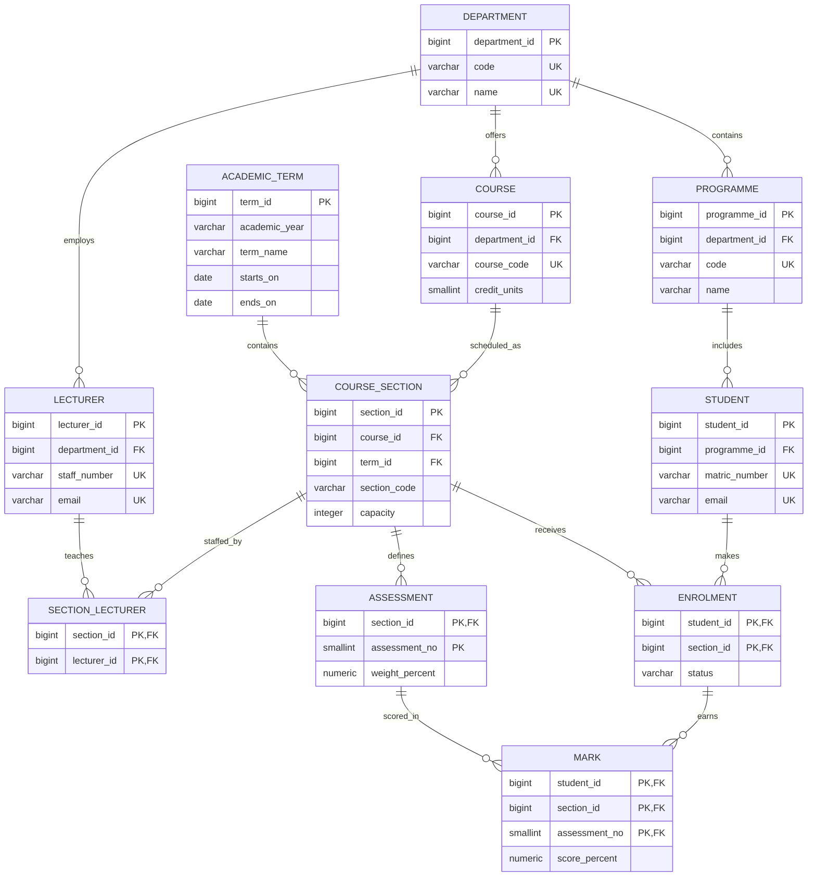

# Entity Relationship Diagram

`MARK` references both the student's enrolment and the section's assessment using composite foreign keys. This prevents recording a mark for an assessment in a different section from the student's enrolment.
