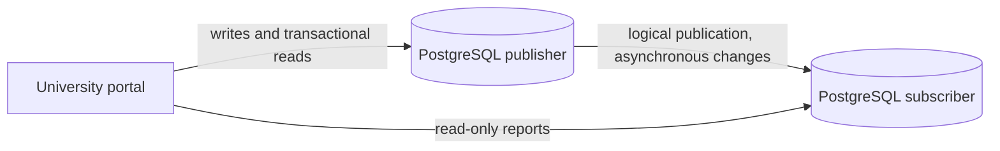

# PostgreSQL Logical Replication Architecture

## Case-study use

The primary hosts the university registration and results database. The application sends enrolment changes, mark updates, and administrative writes to the primary. Reporting requests can read from the subscriber to reduce read load on the primary.

The Compose setup uses logical replication for the Portfolio 1 tables. The subscriber receives an initial table copy, then changes from the publication. The two local containers model separate database nodes on a private network.

## Consistency and availability

- Replication is asynchronous by default. A read sent to the subscriber may be stale until the apply worker catches up. Read-after-write actions such as confirming a newly registered course should go to the primary or wait for a replication position.
- If the subscriber is paused or disconnected, the primary can continue accepting writes, but subscriber reads become increasingly stale. The run check demonstrates this by pausing replication, changing a section's capacity on the primary, reading the old capacity from the subscriber, and then resuming replication.
- A subscriber can serve reads during a primary outage only for data it has received. This logical subscriber is not an automatic failover target. Promotion and application routing require an operator or orchestration layer.
- The application should use a read-only role for subscriber traffic. This demo uses the local `postgres` account for administration and does not expose database ports to the host.

## Limits of the demo

PostgreSQL logical replication does not replicate schema changes or sequence state. Schema changes must be applied to both nodes, and sequence values need separate handling before any planned promotion. The subscriber is kept read-only at the application level in this exercise. These are reasons a production deployment would need a documented failover and schema-change procedure.

## References

- [PostgreSQL logical replication](https://www.postgresql.org/docs/16/logical-replication.html)
- [PostgreSQL publications](https://www.postgresql.org/docs/16/logical-replication-publication.html)
- [PostgreSQL subscriptions](https://www.postgresql.org/docs/16/logical-replication-subscription.html)
- [Logical replication restrictions](https://www.postgresql.org/docs/16/logical-replication-restrictions.html)
